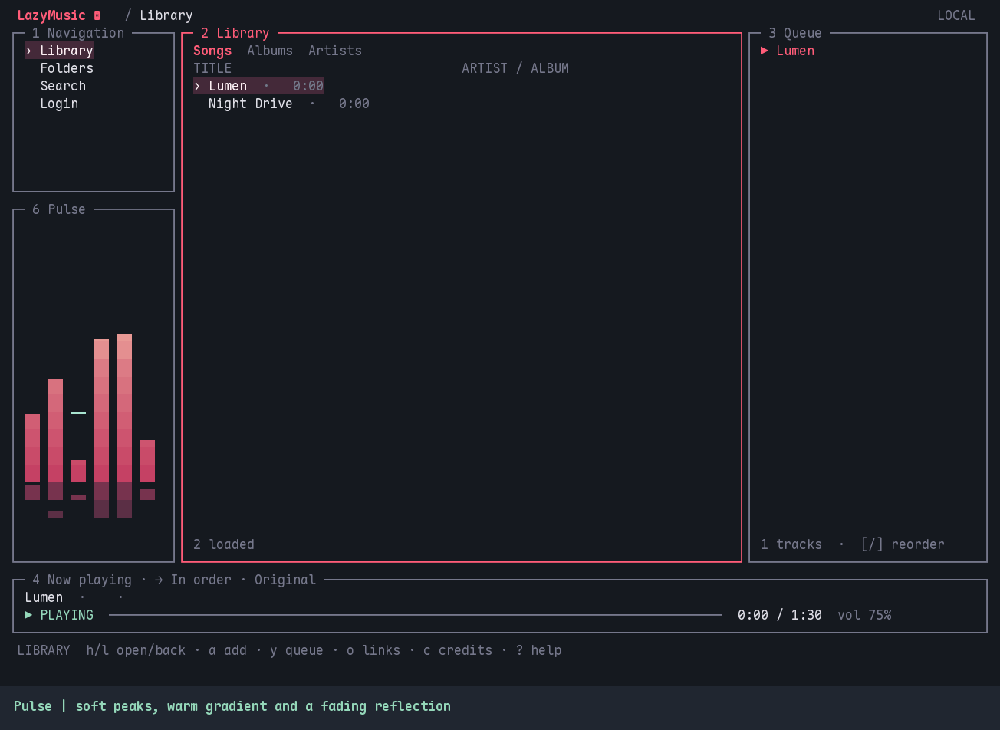
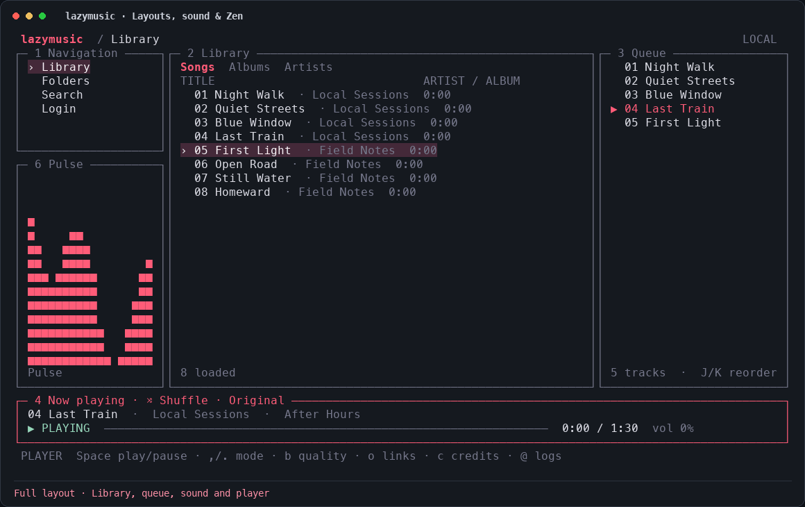
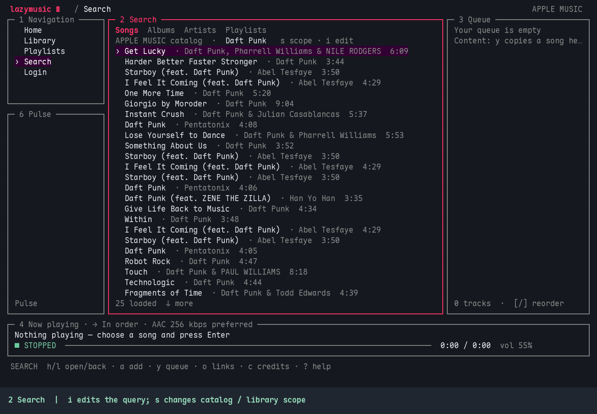
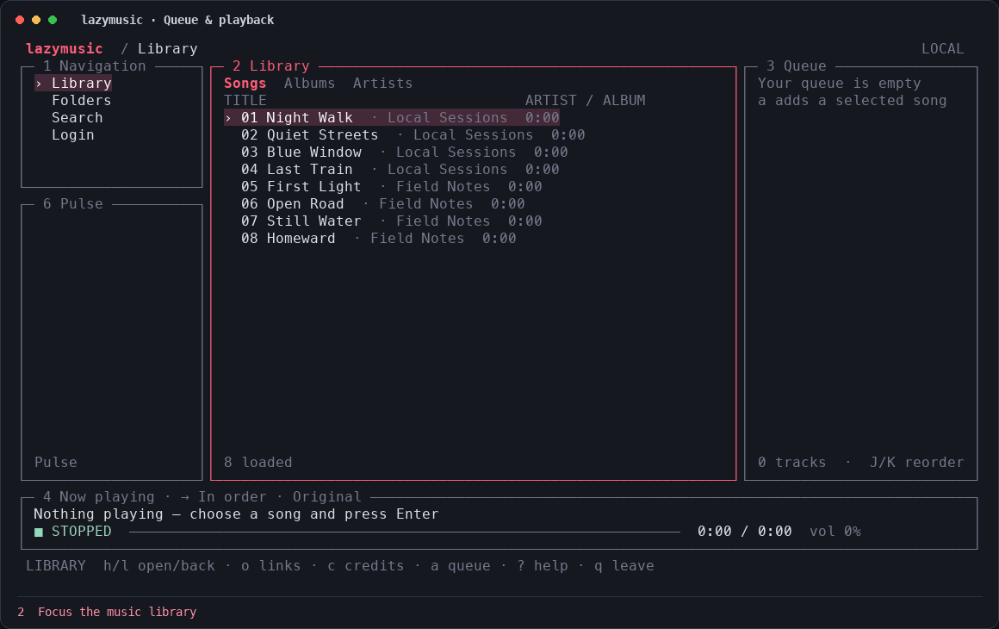
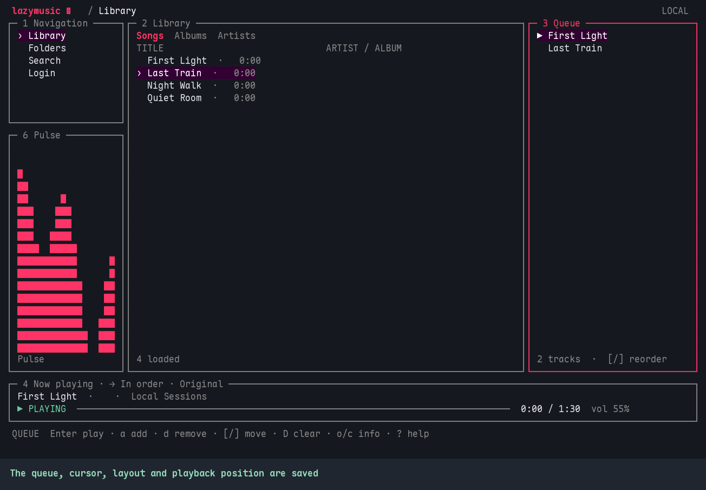

# lazymusic

**把音乐留在终端。** 一个支持 Apple Music 和本地音乐库的音乐 TUI，默认使用 Vim 键位。

在同一界面浏览推荐、搜索收藏、管理队列和调整音效。关闭 TUI 后继续播放，下次打开接着听。

[界面演示](#界面演示) · [安装](#安装) · [快速上手](#快速上手) · [键位](#键位) · [Neovim](#neovim) · [配置](#配置) · [常见问题](#常见问题) · [参与开发](#参与开发)

## 界面演示

以下动图来自真实 lazymusic 终端会话，底部附有按键提示。Apple Music 使用实际目录数据；LOCAL 播放演示使用临时静音 WAV 文件。

**Pulse / Wave**：渐变柱形、峰值余辉与多层细曲线；前端以独立的 30 FPS 时钟更新，暂停时平滑收束。使用 `,.` 切换，`Ctrl+-` 进入 Zen。



**布局与音效**：`+` / `_` 切换布局，`H/J/K/L` 调节窗口，`Ctrl+-` 进入 Zen，调整均衡器后用 `Ctrl+=` 恢复默认布局；`@` 查看运行日志。



<details>
<summary>展开查看 Apple Music 搜索、队列播放和后台恢复</summary>

**Apple Music 搜索与作品信息**：输入搜索词，按 `o` 跳转到歌曲所在专辑，`h` 返回，按 `c` 查看可用 credits，再用 `.` 切换搜索类型。



**队列与播放控制**：`y` 加入队列，`3` 聚焦队列后按 `Enter` 播放；在任意面板用 `m` 轮转播放模式，`Ctrl+>` 快进，`Space` 暂停或继续，`>` 切到下一首。



**后台运行与 session 恢复**：按 `q q` 关闭 TUI 并继续播放，重新运行 lazymusic 回到原来的队列、界面和播放位置；`q Q` 完全退出。



</details>

## 功能

- **两种音乐来源**：Apple Music 个性化推荐、New、Radio、收藏、歌单和搜索；LOCAL 浏览并播放自己的音乐目录。
- **键盘优先**：Vim 导航、面板焦点切换、可调分栏，以及 Content / Queue 精简布局。
- **持续播放**：独立后台服务保存队列、位置和界面，重新运行即可恢复 session。
- **播放控制**：播放、暂停、停止、切歌、快进退、随机和循环；直接调整系统默认输出音量。
- **音效与 Zen**：十段均衡器、预设及旁路；Zen 同屏显示律动、均衡器和播放条。
- **运行日志**：`@` 查看日志；运行错误显示 3 秒提示，不抢走当前焦点。

### 音乐来源

| 来源 | 浏览与搜索 | 播放与音质 |
| --- | --- | --- |
| APPLE MUSIC | 按平台分类的 Home 推荐、New、Radio、个人收藏、歌单、catalog / library 双范围搜索 | 原生歌曲、动态电台及电台节目播放，提供 AAC 64 / 256 kbps 偏好；需要有效订阅 |
| LOCAL | 默认 `~/Music`，支持自定义目录、目录浏览和文件名搜索 | 直接播放原文件，格式支持取决于系统解码器 |

Apple Music **仅授权时临时使用浏览器，播放不依赖浏览器**。当前授权使用固定版本、校验摘要的 Vibez 官方组件，Apple 授权页中的应用身份为 **Vibez**，依赖其授权服务。首次使用会下载授权组件和播放所需的 CDM；凭据保存在本机私有目录。

当前 Apple 后端尚未验证出真正的无损 / Hi-Res，因此音质菜单只展示可兑现的 AAC 选项。LOCAL 不转码，也不读取 Apple 下载的 DRM 文件；暂不解析音乐文件的嵌入标签。

Home 保留推荐接口返回的全部分类和资源，包括专属电台、视频及暂不支持播放的类型；分类内容支持分页。具体分类由 Apple 按账号、地区和时间返回，不保证与官方 App 首页完全相同，也不会自行补造未返回的分类。

**New / Radio 只在 APPLE MUSIC 下显示**，读取账号地区对应的 Apple 官方公开页面结构化内容，按原分类展示；有完整分类入口时可用 **View all** 打开。这个读取过程不需要运行浏览器，也不会向公开页面发送账号授权。公开页面结构变化或地区重定向会明确报错。视频及尚未接入播放的类型仍会展示，选择时说明限制。

### 电台

在 Home / New / Radio 选中个人、发现、艺人或风格电台，按 `Enter` / `Ctrl+Enter` 开始播放。macOS 和 Linux 均通过原生 AAC 播放器播放 Apple 实际返回的歌曲，并在缓冲队列变短时自动获取下一批；不依赖浏览器。播放条显示电台名称和当前曲目，播放、暂停、切歌、快进退、系统音量与 EQ 使用原有键位。

`q q` 后电台继续播；重新进入保留电台和队列。服务完全退出后，恢复电台、已取得的曲目和位置并保持暂停，继续播放后恢复续播。普通歌曲 / 专辑替换队列或清空 Queue 会结束电台模式。动态电台是无限来源，`y` / `p` 会说明需要直接播放；要添加当前歌曲，可从 Queue / Player 操作。

**电台节目（Radio episodes）** 按单个有限时长作品处理，可以直接播放、用 `y` 加入队列或用 `p/P` 拾取放置，支持跳转进度和恢复。原生后端从 Apple 的 station assets 取得媒体，并通过授权 CDM 处理 CBCS 音频；节目不会被当作歌曲 ID 请求，也不会无限循环取同一集。

动态电台及 CBCS 电台节目都已在 macOS、Linux 实测播放。Apple Music 1 等直播台的原生流刷新路径另有实现及回归测试；当前中国区目录没有提供这些直播台，现有账号的直播媒体请求返回 404，因此尚未完成真实直播验证，不声明完整直播兼容性。不同地区的可用内容以 Apple 实际返回为准。

## 安装

目前从源码安装。需要 **Go 1.25+**、CGO 和 C/C++ 工具链；先按系统准备依赖，再执行下方安装命令。

Apple Music 的授权和 CDM 组件目前支持 **macOS Apple Silicon / Intel、Linux x86_64**。LOCAL 的格式支持由对应平台的音频栈决定。

### macOS

安装 Xcode Command Line Tools，并按 [Go 官方说明](https://go.dev/doc/install) 安装 Go：

```sh
xcode-select --install
go version
```

使用系统 Core Audio / AVFoundation，无需额外安装 GStreamer。

### Ubuntu

安装编译工具、GStreamer 开发包、解码与音频输出插件：

```sh
sudo apt update
sudo apt install -y \
  build-essential pkg-config git ca-certificates \
  libgstreamer1.0-dev gstreamer1.0-tools \
  gstreamer1.0-plugins-base gstreamer1.0-plugins-good \
  gstreamer1.0-libav gstreamer1.0-pulseaudio \
  pulseaudio-utils
```

随后按 [Go 官方说明](https://go.dev/doc/install) 安装 **Go 1.25 或更新版本**。Ubuntu 仓库里的 `golang-go` 可能低于此要求，请先检查 `go version`。

| 依赖 | 用途 |
| --- | --- |
| `build-essential`、`pkg-config`、`libgstreamer1.0-dev` | CGO / C++ 编译与 GStreamer 链接 |
| `gstreamer1.0-plugins-base`、`gstreamer1.0-plugins-good` | 播放管线、常用格式和音频输出 |
| `gstreamer1.0-libav` | AAC 等音频解码 |
| `gstreamer1.0-pulseaudio` | 通过 PulseAudio 或 PipeWire 的 PulseAudio 兼容服务输出音频 |
| `pulseaudio-utils` | 提供 `pactl`，用于系统音量；已有 `wpctl` 时优先使用它 |

在普通用户的桌面音频会话中运行。仅有 SSH 或无音频服务的服务器，需要先配置可用的输出设备和用户音频服务。相关包说明见 [GStreamer 官方安装文档](https://gstreamer.freedesktop.org/documentation/installing/on-linux.html)、[Ubuntu 解码插件](https://packages.ubuntu.com/noble/gstreamer1.0-libav)和[音量工具](https://packages.ubuntu.com/noble/pulseaudio-utils)。

### 编译与安装

```sh
git clone https://github.com/lixuan998/lazymusic.git
cd lazymusic
make install
```

默认安装到 `~/.local/bin/lazymusic`，不需要 `sudo`。同时会安装 Lua 插件到 `~/.local/share/lazymusic/nvim`，并创建或更新 `~/.config/nvim/lua/plugins/lazymusic.lua`（设置 `XDG_CONFIG_HOME` 时使用相应目录）。配置指向已安装的插件与 binary，重启使用 lazy.nvim / LazyVim 的 Neovim 后即可用 `<leader>mm` 打开。

已有配置内容不同时，会先保存同目录下的 `lazymusic.lua.bak-*` 备份；重复安装相同内容不会产生多余备份。如果 binary 目录尚未加入 `PATH`：

```sh
export PATH="$HOME/.local/bin:$PATH"
lazymusic
```

将这行 `export` 加入 `~/.zshrc` 或 `~/.bashrc`，即可在新终端中直接运行。

也可以只编译，或指定安装位置：

```sh
make build                              # 产物：bin/lazymusic
./bin/lazymusic
make install PREFIX="$HOME/Applications/lazymusic"  # 安装到 PREFIX/bin
make install BINDIR="$HOME/bin"          # 直接指定 binary 目录
make install NVIM_CONFIG_DIR="$HOME/.config/nvim-work" # 指定 Neovim 配置目录
make install INSTALL_NVIM=0              # 仅安装 binary
```

`make install` 会先编译；支持 `GO`、`INSTALL`、`PREFIX`、`BINDIR`、`NVIM_CONFIG_DIR`、`NVIM_PLUGIN_DIR` 和用于打包的 `DESTDIR` 覆盖。`DESTDIR` 同时用于 binary、插件与配置文件的 staging；生成的配置仅引用最终安装路径。

### 更新与卸载

退出正在运行的 TUI，并停止相应来源的后台服务后更新：

```sh
lazymusic quit
git pull --ff-only
make install
lazymusic
```

如曾使用多个来源，可通过 `--source apple` / `--source local` 分别停止其服务；使用自定义状态目录时需同时传入相同的 `--state-dir`。

```sh
make uninstall
# 自定义安装位置时，传入与安装时相同的 PREFIX 或 BINDIR
make uninstall BINDIR="$HOME/bin"
```

卸载只删除 binary；Neovim 配置与 Lua 插件、登录信息和 session 会保留。卸载前可用 `lazymusic logout` 清除当前来源的登录与 session。

## 快速上手

1. 运行 `lazymusic`，在 Content 的 Login 页面选择 **APPLE MUSIC** 或 **LOCAL**，按 `Enter` / `l` 确认。
2. Apple Music 按官方页面提示完成授权；LOCAL 默认使用 `~/Music`，也可在 Login 中修改目录。
3. 按 `1` 进入 Navigation，使用 `j/k` 选择页面，按 `l` / `Enter` 进入内容。APPLE MUSIC 提供 Home、New、Radio、Library、Playlists、Search；LOCAL 按实际能力显示页面。在 Content 使用 `,/.` 切换平台提供的分类。
4. 歌曲按 `Enter` 播放；专辑、歌单或艺人按 `Ctrl+Enter` 播放全部，按 `y` 加入队列。也可用 `p/P` 拾取，再到 Queue 指定位置放置。
5. 按 `q` 打开离开提示，再按 `q` 后台播放；下次运行 `lazymusic` 恢复。在离开提示中按 `Q` 则完全退出当前来源的服务。

直接指定本地音乐目录：

```sh
lazymusic --source local --music-dir "$HOME/Music"
```

切换来源会暂停之前的来源，各自保留队列和界面。后台恢复会连接仍在播放的服务；服务已退出时，恢复队列及位置并保持暂停。

### WSL 或无法自动打开浏览器

选择 **APPLE MUSIC** 后按 `Enter` / `l` 开始登录。首次运行可能先下载授权组件，页面会显示当前准备阶段。授权服务启动后，官方组件约需 4 秒输出链接；Login 面板顶部会显示完整的手动链接（包括本次授权的 `state` 参数），并尝试自动打开浏览器。按 `y` 通过终端剪贴板协议复制链接，或直接选择、点击显示的地址。保持 lazymusic 运行，在 Apple 官方页面完成授权。

在 WSL 中，可将该链接打开在 Windows 浏览器中；这依赖 Windows 到 WSL 的 localhost 转发，参见 [Microsoft WSL 网络说明](https://learn.microsoft.com/en-us/windows/wsl/networking)。手动链接仅在当前登录过程中显示，取消、完成或超时后失效，不写入日志或 session。通过 SSH 在其他机器上登录时，需要先将相同的 localhost 端口转发到浏览器所在机器。

Ubuntu 22.04 默认的 C++ 运行库可能无法启动官方授权组件（缺少 `GLIBCXX_3.4.32`）。lazymusic 会在检测到这种兼容性问题时，自动下载并校验固定版本的 [conda-forge GCC 运行库](https://github.com/conda-forge/ctng-compilers-feedstock)，保存在当前来源的 `helpers/runtime/` 下，只由授权子进程加载；无需安装 Conda、添加软件源或升级系统运行库。首次准备需要能访问 `conda.anaconda.org`。新版系统通过检查后不会下载兼容库。

如果授权组件在生成链接前失败，Login 会保留具体原因，`@` 可查看日志：缺少 GStreamer 动态库时安装上方 Ubuntu 依赖；DNS、代理或证书失败时按提示检查网络。复制功能需要终端支持 OSC 52，Neovim 浮窗使用编辑器配置的 clipboard provider；不支持时仍可手动复制屏幕上的链接。

## 键位

按 `?` 只查看 **当前面板 + Global** 的命令，`j/k`、`Ctrl+u/d` 滚动帮助，`?` / `Esc` 关闭。最低终端尺寸为 **60 × 16**。输入搜索词、目录或歌单名称时，字母就是文本，`Esc` / `Ctrl+c` 取消。

### Global

| 按键 | 操作 |
| --- | --- |
| `Ctrl+h/j/k/l` | 焦点移向左 / 下 / 上 / 右面板 |
| `1`–`6` | Navigation / Content / Queue / Player / Log / Sound |
| `Tab` / `Shift+Tab` | 下一个 / 上一个面板 |
| `H/J/K/L`（`Shift+h/j/k/l`） | 向左 / 下 / 上 / 右调整当前面板尺寸 |
| `+` / `_` | 轮换完整、Content + Player、Queue + Player 布局 |
| `Ctrl++` / `Ctrl+-` | Zen：律动 + Equalizer + Player |
| `Ctrl+=` | 恢复默认布局 |
| `Space`、`x` | 播放 / 暂停、停止，在所有面板可用 |
| `<` / `>` | 上一曲 / 下一曲 |
| `Ctrl+<` / `Ctrl+>` | 后退 / 前进 10 秒（通常是 `Ctrl+Shift+,` / `Ctrl+Shift+.`） |
| `m` | 轮转播放模式，在所有面板可用 |
| `=` / `-` | 系统默认输出音量 ±5% |
| `@` | 打开 / 关闭运行日志 |
| `?` | 当前面板帮助 |
| `:` | 命令行，如 `:login`、`:seek 30`、`:vol 50` |
| `q` → `q` / `Q` | 后台运行 / 完全退出当前来源服务 |

尺寸调节使用普通大写字符，不再依赖 `Ctrl+Shift+j`。Ghostty 等终端的屏幕快照粘贴快捷键会在应用收到按键前执行；`H/J/K/L` 避开这类修饰键冲突。需要终端上报修饰键的操作仍使用增强键盘协议。

### 面板内命令

列表通用：`j/k` 上下，`gg/G` 首尾，`Ctrl+u/d` 半页；`h/l` 返回上级 / 打开下级，`Enter` 确认或播放。这些命令只作用于当前面板。

| 面板 | 按键 | 操作 |
| --- | --- | --- |
| 1 Navigation | `j/k`、`l` / `Enter` | 选择页面、进入 Content；选中 Login 后确认进入 |
| 1 Navigation | `,/.` | 切换下方 Pulse / Wave / Equalizer / Turntable |
| 2 Content | `,/.`、`r`、`/` | 分类 / 搜索类型、刷新、过滤已加载内容 |
| 2 Content · Search | `i`、`s` | 编辑搜索词、切换 catalog / library 范围 |
| 2 Content | `Ctrl+Enter`、`y` | 播放歌曲或整个集合、直接加入队列；添加菜单中 **Play next** 安排为下一首 |
| 2 Content | `p` / `P` | 拾取单曲或完整集合，切到 Queue 后选择插入位置 |
| 2 Content | `a`、`d` | 当前作品添加菜单、移除收藏入口；Playlists 列表中 `a` 新建歌单 |
| 2 / 3 / 4 | `o`、`c` | 专辑 / 艺人跳转、credits |
| 3 Queue | `Enter` | 播放选中的歌曲 |
| 3 Queue | `p` / `P`、`Esc` | 未拾取时任一键拾取歌曲；拾取后 `p` 放到光标歌曲后、`P` 放到前，`Esc` 取消 |
| 2 Content / 3 Queue | `u` | 撤销最近一次 pick & place，再按重做 |
| 3 Queue | `f` | 定位当前播放曲目，并尽量居中显示；靠近队列首尾时按边界显示 |
| 3 Queue | `r` / `s` | 调整循环 / 随机，仅 Queue / Player 可用 |
| 3 Queue | `a`、`d`、`D` | 添加到收藏 / 歌单、移除队列项、清空队列 |
| 3 Queue | `[` / `]` | 将选中的歌曲向上 / 下移动 |
| 4 Player | `,/.`、`b` | 轮换组合播放模式、音质偏好；`r/s` 分别调循环和随机 |
| 4 Player | `a` | 将正在播放的歌曲加入收藏 / 歌单 |
| 5 Log | `j/k`、`gg/G` | 滚动、首条 / 最新日志 |
| 6 Sound | `,/.` | 切换 Pulse / Wave / Equalizer / Turntable |
| 6 Sound · EQ | `h/l`、`j/k` | 选择频段、降低 / 提高 1 dB |
| 6 Sound · EQ | `e`、`r`、`p` | 旁路、归零、轮换 Flat / Bass / Vocal / Treble 预设 |
| 2 Login | `j/k`、`l` / `Enter`、`h`、`y` | 选择来源、进入 / 确认、返回；账户选项中 `r` 重新授权，授权过程中 `y` 复制完整链接 |

同一个字母可以在不同面板复用，如 Content / Queue / Player 的 `a`、Content / Queue 的 `d`，以及 Content / Sound 的 `p`。全局 `m` 轮转播放模式；`r/s` 只在 Queue / Player 调整循环和随机。Content 刷新用 `r`，Search 范围用 `s`，EQ 归零用 `r`。尺寸调节统一用大写 `H/J/K/L`，Queue 调序用 `[/]`，Login 使用 Navigation 或 `:login`。

窗口 6 的 **Turntable** 是黑胶播放台：在 Navigation / Sound 用 `,/.` 切换，封面嵌入唱片，下面展示专辑、艺人和歌名；播放时唱片高光缓缓转动，暂停后平滑停止。Apple Music 自动获取当前曲目的封面；LOCAL 读取同目录的 `cover.jpg/jpeg/png`、`folder.jpg/png` 或 `front.jpg/png`（文件名不区分大小写）。没有封面时显示默认唱片。使用彩色半格字符绘制，不依赖图片程序或终端图像协议，在 Neovim 浮窗中同样可用。封面只在内存中缓存，切歌与隐藏视图会取消旧请求。

顶部品牌、当前页面和来源统一放在边框内；Player 默认加高，分行显示曲目、艺人 / 专辑、进度、播放状态、系统音量和模式 / 音质。小终端自动收紧布局，仍可用 `H/J/K/L` 调整。

拾取的内容会以 `◆` 和底部状态提示显示。从 Queue 拾取再放置是移动；从 Content 拾取后放置是复制加入。单曲插入一首，album / playlist 插入其全部歌曲，artist 会展开其专辑中的全部歌曲，包含分页，按来源顺序整体插入；空 Queue 直接插入。集合准备期间可继续导航，`Esc` 取消准备；提交放置后等待结果，重复按键不会重复插入。拾取状态只在当前前端保留，Queue 的滚动位置随 session 保存。若队列已经变化，放置会要求重新选择位置，避免使用旧索引修改错误的歌曲。

在 Content 或 Queue 按 `u` 撤销最近一次成功放置，再按 `u` 重做，可反复切换，直到下一次成功放置更新记录。整组插入会一起撤销；取消、失败或没有改变位置的放置不覆盖记录。记录随 session 保存。撤销不回滚播放进度；如果移除的恰好是当前播放的插入曲目，会停止它并选中相邻曲目，重做也保持暂停。队尾追加（含电台续播）可保留记录；其他删除、重排或替换队列会使旧记录失效，以免操作错误的歌曲。

`h/j/k/l` 单击立即生效，长按在当前窗口连续移动；没有连按切窗或输入等待。切窗仅用 `Ctrl+h/j/k/l`。输入搜索、目录和歌单名称时，普通字母保持文本含义。

均衡器支持 **32 Hz–16 kHz 十段、±12 dB**，应用于实际输出并随 session 保存。

Pulse 用带间距的渐变柱形、缓降峰值和淡色倒影；Wave 用每个字符 2×4 点的细曲线叠加，适配左侧小面板和 Zen 大视图。两者使用独立的前端 30 FPS 时钟，播放进度轮询和跳转不会带着画面跳动。暂停、恢复与切换样式都有渐变过渡；暂停回落后、精简布局或弹窗遮住律动时停止动画刷新，不增加后台轮询和 session 写入。它们是装饰律动，未进行实时音频频谱分析。

### Apple Music 收藏与歌单

- 在 Search / Home 选中歌曲或专辑，按 `a` 选择 **Music library**，添加歌曲或整张专辑。Library / 资料库搜索返回的项目不会再显示重复收藏入口。
- 在 Playlists 列表按 `a`，输入名称、`Enter` 新建歌单；空列表也可创建。
- 在 Content / Queue / Player 的歌曲上按 `a` → **Choose playlist**，从可编辑歌单中选择目标。只读推荐歌单不会混入目标列表，提交前会再次检查编辑权限。
- `y` 直接加入播放队列，添加菜单的 **Play next** 安排为下一首；收藏和云端歌单写入不会打断正在播放的音乐。

Apple 返回 **202 Accepted** 时会提示已受理；同步可能稍有延迟，可在 Content 按 `r` 刷新。写入请求不会自动重试，遇到连接错误应先检查 Apple Music 中的实际结果，再决定是否重试。

**当前限制：Apple 公开 API 不提供删除收藏歌曲、专辑或歌单的接口。** `d` 会展示后端的限制说明，实际删除请使用 Apple Music 官方客户端；不会在本地假装删除。此限制适用于 macOS 和 Linux。参见 [Apple API 总览](https://developer.apple.com/documentation/applemusicapi/)、[添加收藏](https://developer.apple.com/documentation/applemusicapi/add-a-resource-to-a-library)及 [Apple 对删除接口的说明](https://developer.apple.com/forums/thread/107807)。LOCAL 不提供文件删除操作。

### 作品信息

在 Content 选中作品、Queue 选中歌曲或聚焦 Player 时，按 `o` 打开跳转菜单。专辑和每位艺人分别列为一项，使用 `j/k` 选择，`Enter` / `l` 在 Content 中打开，`h` 返回原页面，不改变播放队列。

按 `c` 查看音源实际提供的贡献者、角色、作曲及发行信息；没有完整名单时会明确注明。用 `j/k` 或 `Ctrl+u/d` 滚动，`Esc` 关闭。LOCAL 当前按文件与目录组织，尚不读取嵌入式 credits。

## Neovim

仓库内包含 Neovim 0.10+ 插件，用 `<leader>mm` 在浮动终端打开 lazymusic。`make install` 会自动部署本地插件并生成 lazy.nvim 配置，无需手动复制，也不需要插件管理器另外下载仓库。

如果安装时使用 `INSTALL_NVIM=0` 跳过自动接入，也可以将以下配置加入 `lazy.nvim` 插件列表；LazyVim 可保存为 `lua/plugins/lazymusic.lua`，通过 Git 管理插件版本：

```lua
return {
  {
    "lixuan998/lazymusic",
    main = "lazymusic",
    cmd = { "LazyMusic", "LazyMusicHide" },
    keys = {
      { "<leader>mm", function() require("lazymusic").open() end, desc = "Open lazymusic" },
    },
    opts = {
      cmd = "lazymusic", -- 默认查找 PATH，再查找 ~/.local/bin/lazymusic
      args = {},        -- 例如 { "--source", "local" }
      width = 0.84,
      height = 0.82,
      border = "rounded",
    },
  },
}
```

本地开发可将仓库地址替换为 `dir = "/absolute/path/to/code/lazy-music"`。插件不代替 binary 安装；可用 `opts.cmd` 指定可执行文件的完整路径，参数通过 `opts.args` 逐项传入，不经过 shell。

重复打开会复用已有终端；`:LazyMusicHide` 只隐藏浮窗。TUI 内 `q q` 会关闭浮窗并保持后台播放，`q Q` 停止当前来源服务；再次 `<leader>mm` 恢复 session。`Esc`、`Ctrl+h/j/k/l`、`Ctrl+u/d`、`H/J/K/L` 和布局修饰键使用当前 buffer 的透传映射，不影响其他终端。插件将按键交给 TUI；`?` 与直接运行一致，只显示当前面板及 Global。

需要临时回到 Neovim 普通模式时，先按 `Ctrl+反斜杠`，再按 `Ctrl+n`。自动安装后可使用 `:help lazymusic`，也可阅读 [插件帮助](docs/lazymusic.txt)。

## 配置

| 位置或选项 | 含义 |
| --- | --- |
| macOS：`~/Library/Application Support/lazymusic` | 默认配置和私有运行目录 |
| Linux：`$XDG_CONFIG_HOME/lazymusic`，未设置时为 `~/.config/lazymusic` | 默认配置和私有运行目录 |
| `--state-dir PATH` / `LAZYMUSIC_STATE_DIR` | 使用指定的精确状态目录 |
| `--music-dir PATH` | 设置 LOCAL 音乐根目录，需同时选择 `--source local` |
| `keys.json` | 当前来源状态目录中的自定义按键 |

默认情况下，Apple Music 使用主状态目录，LOCAL 使用其下的 `profiles/local`；队列、授权和 session 按来源隔离。

`keys.json` 以动作名覆盖对应的默认绑定，例如为帮助添加 `F1`：

```json
{
  "help": ["?", "f1"]
}
```

动作名与默认值见 [keys.go](internal/tui/keys.go)。同一按键可分配给不同面板的动作；同一面板内、以及面板与 Global 之间不能冲突。启动时会校验。旧版 keys.json 的动作名仍可覆盖，新动作及默认值以注册表为准。

也可通过 CLI 查看或控制当前来源：

```sh
lazymusic sources
lazymusic status
lazymusic ctl --op pause
lazymusic ctl --op quality --quality high
lazymusic quit
```

## 常见问题

### Ubuntu 编译或播放缺少插件

先确认 Go 版本与上述依赖已安装，检查 GStreamer：

```sh
go version
pkg-config --modversion gstreamer-1.0
gst-inspect-1.0 playbin3
gst-inspect-1.0 avdec_aac
pactl info
```

缺少 `playbin3` 时检查 `gstreamer1.0-plugins-base`；缺少 `avdec_aac` 时检查 `gstreamer1.0-libav`。若 `apt` 找不到这些包，检查是否启用了 Ubuntu 的 Universe 仓库。无声音或无法调整音量时，检查当前用户的 PipeWire / PulseAudio 会话和默认输出设备，使用普通用户运行 `lazymusic`。

### 在哪里看错误？

按 `@` 查看运行日志。warning / error 提示会在 3 秒后自动消失，不改变焦点，日志仍保留；切换页面时的正常请求取消不会作为错误上报。私有状态目录中的 `runtime.log` 保留轮转日志，`service.log` 用于服务启动诊断。提交 issue 前请检查日志中没有个人信息或凭据。

Apple 多设备播放冲突如果由服务返回明确错误，会显示脱敏后的原因；没有明确原因时，不把普通暂停猜测为多端冲突。

### 为什么没有 Apple Music Hi-Res 选项？

当前音源链路提供 AAC，曲目的无损标签不等于实际播放格式。macOS 原生 MusicKit 的实测也尚未得到 ALAC 解码证据。现阶段不显示未验证的音质选项；入口仍为 Player 中的 `b`，未来由后端能力扩展。

### 更新后无法连接服务？

旧后台进程可能仍在运行旧协议。先退出 TUI，运行 `lazymusic quit`，再重新进入；自定义来源或状态目录应传入相同参数。同一来源同时只允许一个 TUI 持有界面写入权。

## 参与开发

```sh
make build
make test
make test-nvim  # 修改 Neovim 插件时运行，需要 nvim
make vet
make help
```

代码分为平台无关的浏览与播放合约、来源实现、后台服务和 TUI；新增平台从 backend registry 接入。工程结构、session / 安全约定及新来源接入步骤见 [AGENTS.md](AGENTS.md)。

欢迎通过 [Issues](https://github.com/lixuan998/lazymusic/issues) 报告问题或讨论新来源。请附上系统、架构、终端、Go 版本和复现步骤。提交改动前运行检查；不要提交登录凭据、CDM、辅助 binary、一次性探针或构建产物。

## 致谢

- [Bubble Tea](https://github.com/charmbracelet/bubbletea) 与 [Lip Gloss](https://github.com/charmbracelet/lipgloss)：终端交互与绘制。
- [Vibez](https://github.com/simonepelosi/vibez)：当前 Apple 授权组件与固定版本的原生播放代码子集。来源清单见 [vibez-source.json](third_party/vibez-source.json)，保留其 [MIT 许可证](third_party/VIBEZ-LICENSE)。
- [conda-forge GCC runtimes](https://github.com/conda-forge/ctng-compilers-feedstock)：旧版 Linux 的授权组件兼容运行库，按需下载，不随 binary 分发；采用 [GPLv3](https://www.gnu.org/licenses/gpl-3.0.html) 及 [GCC Runtime Library Exception 3.1](https://www.gnu.org/licenses/gcc-exception-3.1.html)。
- Chromium CDM 接口头文件遵循 [BSD 3-Clause](third_party/CHROMIUM-CDM-BSD-3-Clause.txt)。下载的 CDM 组件不随源码分发。
